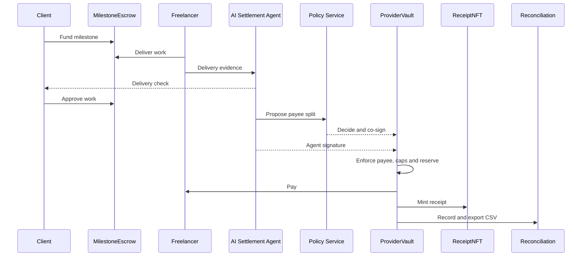
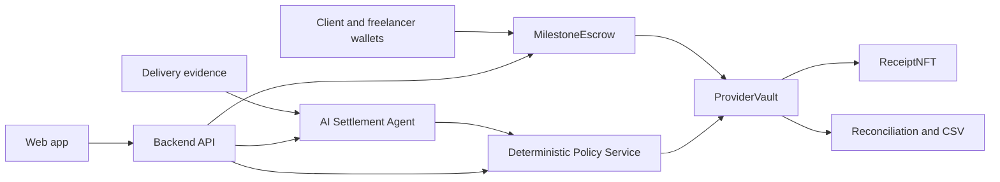

# Tethran

**Enforceable, traceable, deliverable payments for Africa's freelancers and agencies**

[](https://sepolia.etherscan.io/)
[](https://github.com/tetherto/wdk)
[](contracts/)
[](services/)
[](#tests)

Built for the **W3Node Node Engine Hackathon 2026, Mobile Money & Peer-to-Peer track (Tether)**.

Runs on Sepolia with our own test token, `TestUSDT`.

## Demo

▶ Watch the 3-minute demo: `<VIDEO_URL>`


## The problem

Freelancers and agencies can be paid late.
They can be paid without protection while work is reviewed.
They need proof of delivery, approval and payment.
Cross-border payout decisions also need clear rules and an audit trail.

## The solution

Tethran turns a deliverable into an enforceable milestone contract.
Funds move through escrow, while an untrusted AI proposes a settlement and deterministic policy decides it.
The result is a two-signature payout, a soulbound receipt and a reconciliation record.

### How it works



## Key features

| Feature | Benefit |
|---|---|
| Milestone escrow | Holds each funded milestone until approval or dispute resolution. |
| AI Settlement Agent | Proposes payees and reserves; it is untrusted and proposes only. |
| Deterministic Policy Service | Applies reason-coded rules and co-signs an allowed plan. |
| ProviderVault | Requires two signatures, a payee allowlist, caps and a reserve. |
| Soulbound ReceiptNFT | Leaves a non-transferable receipt for the settled milestone. |
| Delivery check | Compares delivery evidence with milestone acceptance criteria. |
| Wallet connect | Reown AppKit supports a user's wallet for the real signing path. |
| Role dashboards | Client, freelancer, operator and arbiter work from focused queues. |
| Invoice email and notifications | Sends invoice links and keeps each role's activity visible. |
| 5% platform fee | Code computes it; policy enforces the fee line and destination. |
| Tax reserve and CSV export | Keeps the reserve in the payout plan and exports reconciliation data. |
| x402 endpoints | Supports on-chain TestUSDT payments for the data endpoints. |

## Why it is different

- The AI never holds keys and cannot approve its own proposal.
- Rules are enforced twice: by the deterministic Policy Service and on-chain vault guards.
- Two signatures are required before the vault pays.
- Every step is traceable from milestone funding to receipt and reconciliation.

## Built with Tether WDK

Tethran uses `@tetherto/wdk` for wallet registration and transaction policies,
`@tetherto/wdk-wallet-evm` for EVM accounts, balances, transfers and `signTypedData`,
and `@tetherto/wdk-failover-provider` for RPC failover. WDK accounts sign user-side
deposits, approvals, disputes, contract attestations and x402 authorizations.

We built the milestone escrow, two-signature ProviderVault, ReceiptNFT, Policy Service,
Settlement Agent boundary, reconciliation ledger, role dashboards and delivery workflow
around those primitives. The contracts and services keep chain access, policy decisions
and signing responsibilities explicit.

## Tech stack

| Layer | Stack |
|---|---|
| Contracts | Solidity, Hardhat, EIP-3009, EIP-712 |
| Wallets | Tether WDK, EVM wallet manager, failover provider |
| Services | Node.js, TypeScript, ethers |
| Policy and AI | TypeScript Policy Service, Groq/Gemini provider boundary, Opik tracing |
| Web app | Vite, React, TanStack Start, Tailwind, shadcn/ui |
| Data and delivery | SQLite demo data, Resend email, Reown AppKit, x402 endpoints |

## Quick start

### Prerequisites

- Node.js 22.13 or newer
- Sepolia RPC access and test ETH for the Sepolia path

Install dependencies and generate throwaway test keys:

```bash
cd contracts && npm install && npm run wallets
for d in services/chain services/policy services/llm services/backend app; do (cd $d && npm install); done
```

Start the complete demo with one command:

```bash
cd services/backend && CHAIN=localhost npm run demo   # local chain; deploys if needed
cd services/backend && CHAIN=sepolia npm run demo     # Sepolia; uses deployed contracts below
```

The demo serves:

| Service | Address |
|---|---|
| Web app | http://localhost:3000 |
| Backend API | http://127.0.0.1:18788 |
| Policy Service | http://127.0.0.1:18787 |
| Demo signer | http://127.0.0.1:18789 |

The first Sepolia seed takes about 40 minutes. To serve an existing seed without reseeding:
`cd services/backend && npm run demo:serve`. The step-by-step journey is in
[docs/DEMO.md](docs/DEMO.md).

## Tests

| Command | Existing coverage |
|---|---|
| `cd contracts && npm test` | 122 contract tests |
| `cd services/chain && npm test` | 40 ChainClient, WDK policy, RPC and failover tests |
| `cd services/policy && npm test` | 171 Policy Service, co-signing and HTTP API tests |
| `cd services/llm && npm test` | 61 provider, agent and guard tests |
| `cd services/backend && npm test` | 175 treasury, settlement, wallet, x402 and reconciliation tests |
| `cd app && npm test` | 21 app API, demo wallet and reason-code tests |
| `cd app && npm run e2e:demo-short` | Playwright live-demo smoke test |

The Sepolia integration command is `cd services/backend && CHAIN=sepolia npm run slice`.
The model evaluation command is `cd services/llm && npm run eval:agent`.

## Architecture

The app is an interface. Chain access is isolated in `services/chain`; policy and signing
are separate boundaries; the backend orchestrates the flow.



| Folder | Responsibility |
|---|---|
| `contracts/` | TestUSDT, MilestoneEscrow, ProviderVault and ReceiptNFT. |
| `services/chain/` | ChainClient and the WDK wallet layer. |
| `services/policy/` | Deterministic rules, reason codes and policy audit log. |
| `services/llm/` | Agent prompt, provider fallback, guards, tracing and evals. |
| `services/backend/` | Treasury, settlement, invoices, payouts, reconciliation and x402. |
| `app/` | Vite/React role dashboards and wallet-facing interface. |

## Security model

- **Untrusted agent:** the AI returns a proposal only. It has no key and cannot change policy.
- **Deterministic policy:** the Policy Service checks the named milestone, fee, reserve and limits before co-signing.
- **Two-signature vault:** ProviderVault requires the Policy Service signature and agent signer signature, then checks
  the payee allowlist, per-transaction cap, daily cap and reserve on-chain.
- **On-chain caps:** the vault is the final guard on where and how much a payout can send.
- **Soulbound receipts:** ReceiptNFT records a non-transferable receipt for the settled work.

The vault operator is effectively its owner and can replace co-signers, allow payees and raise caps.
The demo signer is a localhost/DEMO_MODE service holding test keys for the operator, arbiter, provider and platform.
Other backend routes are not user-authenticated in this demo server.

## Deployed contracts on Sepolia

Addresses come from [`config/chains.json`](config/chains.json):

| Contract | Address |
|---|---|
| TestUSDT | [`0xE2D587DD9ad01C91DFf0baABc120192C516b9879`](https://sepolia.etherscan.io/address/0xE2D587DD9ad01C91DFf0baABc120192C516b9879) |
| MilestoneEscrow | [`0x172AE76568ba8F83dc7584D2a161713200d9b278`](https://sepolia.etherscan.io/address/0x172AE76568ba8F83dc7584D2a161713200d9b278) |
| ReceiptNFT | [`0x596B49052701d5B83F2098b055C10c08f314d209`](https://sepolia.etherscan.io/address/0x596B49052701d5B83F2098b055C10c08f314d209) |
| ProviderVault | [`0xeE59D8994620A9125641b36848A636E04e24feA8`](https://sepolia.etherscan.io/address/0xeE59D8994620A9125641b36848A636E04e24feA8) |

## Roadmap

- Add a second EVM test network after redeploying the same contracts and configuration.
- Complete x402 facilitator support on an EVM test network.
- Add the planned verification-provider integration.
- Continue the delivery and settlement evaluation work described in the development plan.

## Team

- **Benedict Isaac** — Engineering
- **Sarah Terwase** — Product Manager
- **Gideon Wada** — Design and Motion

## Docs

- [Demo journey](docs/DEMO.md)
- [API reference](docs/API.md)
- [Interfaces](docs/INTERFACES.md)
- [System architecture](docs/03-system-design-architecture.md)
- [Development log](Development.md)

---

[Scope and limitations](docs/SCOPE.md)
