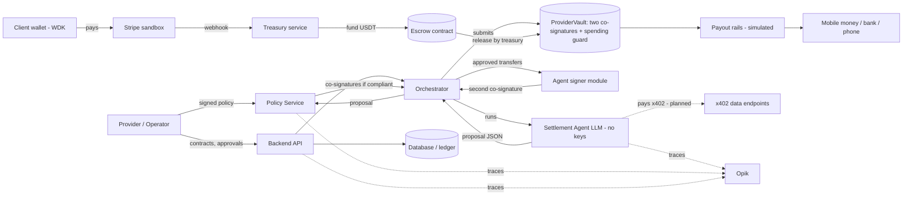

# System Design and Architecture

**Product:** Tethran

**Version:** Draft v0.3 (12 Nov 2026)

**Track:** Mobile Money & Peer-to-Peer (Tether), built on WDK and an EVM test network

**Items marked [TBD] or "verify" are unconfirmed.**

## What changed (12 Nov 2026)

- `docs/INTERFACES.md` (v0.6) is the source of truth for interfaces. Where this document and that file differ, that file wins.
- Escrow (3.2): `createAndFund` stores the parties, vault, timeout and per-milestone hold; FUNDER and RELEASER roles; client-only `approve`; `dispute` only while Funded and before the timeout; `decide` takes exactly two of three EIP-712 attestations; `refundApproved` covers chargebacks and the funder rescue; `minTimeout` is set at deployment.
- Vault (3.3): the spending guard is part of the vault (`ProviderVault`, one per provider), with two co-signatures over a Transfer that has a deadline and a per-action id. The operator key is effectively the owner and a compromised operator key can drain the vault.
- The agent holds no keys and has no submit tool. The orchestrator submits after the Policy Service co-signs; the agent signer module is separate from the LLM (1, 5.2).
- Policy Service: reason codes including `HOLD_ACTIVE` and `BELOW_VAULT_RESERVE`; the tax reserve is measured on the gross milestone amount; `vault_min_reserve` is enforced in the Policy Service and the vault (4.4).
- Receipt NFT (3.4a): holder is the provider; the treasury mints it after the vault payout is confirmed.
- Stack and decisions (2, 3.1, 16): Hardhat 2 with ethers v6, SQLite, Opik cloud, Sepolia as primary chain, own TestUSDT token with EIP-3009; LLM through one provider-agnostic interface (Groq first, Gemini fallback, replay mode).
- Stripe is simulated in this build behind the same interface as the real path; identity, mobile money and bank rails are simulated.
- Marked as planned or not built yet: payout adapters, reconciliation, x402, a second chain, the web app, Stripe checkout creation.

---

## 1. Architecture overview

Three concerns are kept separate:

1. **Proposing:** the LLM Settlement Agent, untrusted.
2. **Authorising:** the deterministic Policy Service, authoritative.
3. **Enforcing:** smart contracts on the EVM test network (escrow, vault, spending guard), final.



## 2. Components

| Component | Responsibility | Trust |
|---|---|---|
| Mobile-first web app | Provider dashboard, client pay link and QR, operator console, arbiter view, wallet review screen. Not built yet (separate workstream, not in this repo) | Untrusted client |
| Backend API | Milestones, funding, release, refunds, receipts, settlement orchestration (see `docs/API.md`). Contracts, invoices and pay links are planned | Trusted |
| Payment bridge | Stripe webhook verification (built, tested with locally signed events). Stripe is **simulated** in this build behind the same interface as the real path; checkout session creation is not built yet | Trusted |
| Treasury service | Holds test USDT. FUNDER and RELEASER of the escrow; funds, releases and refunds escrows, mints receipts. Runs inside the backend | Trusted; keys separate from agent |
| Settlement Agent | LLM planner returning schema-valid proposals. Holds no keys and has no submit tool | **Untrusted** |
| Orchestrator | Backend code: runs the agent, calls the Policy Service, asks the agent signer module to sign, submits the vault transaction, mints the receipt. One Opik trace per run | Trusted |
| Agent signer module | Holds the agent key (first vault co-signer), separate from the LLM; signs only transfers the Policy Service has already signed | Trusted; key never in LLM context, prompts, logs or traces |
| Policy Service | Deterministic limit checks, second signing key, approval queue. Separate process and credentials; reads the chain | Trusted |
| Contracts | `MilestoneEscrow`, `ProviderVault` (one per provider, with the spending guard), `ReceiptNFT`, test token | Authoritative on-chain |
| Wallet layer | Services sign with ethers v6 key wallets; a WDK spike confirmed it fits. WDK wallets for users arrive with the web app (planned) | Self-custodial for users |
| x402 module | Paid data endpoints and agent payments. Planned, not built yet | Trusted |
| Payout adapters | Quote, initiate, status interface; simulated mobile money, bank and USDT; phone registry. Not built yet: in the current slice the vault pays an on-chain wallet that stands for a simulated rail | Trusted |
| Identity service | Simulated verified names and national ID references; checked by the backend before release | Trusted (simulated) |
| Reconciliation store | Invoice ↔ payment ↔ transaction ↔ trace. Not built yet; the milestone timeline endpoint is the first part | Trusted |
| Opik | Tracing, evaluation, guardrails | Observer |

### Technology stack
- Services: TypeScript (Node.js 22.13 or newer), ethers v6. WDK (@tetherto/wdk and the EVM wallet module) is for user wallets and is planned.
- Contracts: Solidity with Hardhat 2 (the 2.x line) and ethers v6, OpenZeppelin 5.
- Web: React, mobile-first. Not built yet. Whether WDK runs in the browser, React Native or Node for user wallets is still **[TBD]**; WDK documents Node.js and React Native support, and a Node spike worked.
- Database: SQLite, with an append-only audit table enforced by triggers.
- Payments: Stripe, simulated in this build (webhook verified; the Express Checkout and Payment Element are planned).
- LLM: one provider-agnostic interface (`LlmProvider`, `services/llm`). Groq first (`openai/gpt-oss-120b`), Gemini fallback (`gemini-3.5-flash`), optional NVIDIA third, and a replay mode. Model names are configuration. Only seeded demo data and redacted text are sent.
- Observability: Opik cloud (TypeScript SDK).

## 3. Chain design (EVM test network)

### 3.1 Network and token
- Primary network: Sepolia (decided). The contracts are deployed there and the full slice has run on it. Base Sepolia has a config entry but is not proven.
- Token: our own `TestUSDT` (decided; it is not Tether USDT): six decimals, open mint as a faucet, and EIP-3009 `transferWithAuthorization` so x402 can settle with it. No Tether test USDT is relied on.
- USDT uses six decimals, so 5 USDT is 5,000,000 base units. Network fees are paid in test ETH; gasless accounts are not used (WDK's ERC-4337 account needs a third-party bundler and paymaster, and is single-owner).

### 3.1a Multi-chain design
- Build and prove one EVM test network first (done on Sepolia). Then add chains behind one interface.
- A `ChainClient` interface (escrow, vault and receipt calls, reads, status by transaction hash, balance; see INTERFACES.md section 3a) is the only place chain details live. The agent, Policy Service and UI never call a chain directly. Every write takes an idempotency key; the client checks that the RPC reports the configured chain id and refuses any chain id on a mainnet deny-list.
- Per-chain config file (`config/chains.json`): `name`, `chainId`, `rpcUrl`, `testnet`, `confirmations`, `usdt`, `escrow`, `receiptNft`. Vault addresses are per provider and live in the `vaults` table. Nothing chain-specific is hard-coded.
- Other EVM chains (for example Arbitrum Sepolia, Polygon Amoy, Base Sepolia) need a redeploy of the same contracts plus config. A second chain is planned and not built yet. Network-mismatch detection then becomes a real feature.
- Non-EVM chains (Tron, Solana, TON) need their own escrow, vault and guard implementations. They are separate work, built only after the EVM flow is complete.
- Milestones, fundings and payouts record the chain they ran on.

### 3.2 Escrow contract
On-chain states per milestone: None, Funded, Approved, Disputed, Released, Refunded. The database adds `draft`, `in_review` and `paid_out` (INTERFACES.md section 0).

| Function | Rule |
|---|---|
| createAndFund(milestoneId, client, provider, arbiter, vault, amount, timeout, cardFunded, holdSeconds) | FUNDER role only (the treasury). Pulls USDT from the funder and stores the parties, vault, amount, timeout and per-milestone chargeback hold. The timeout must be at least now + `minTimeout`, which is set at deployment (1 day by default, 10 minutes on the Sepolia demo deployment). The hold is at most 30 days. The vault and parties may not be the escrow or the token |
| approve(milestoneId) | Client only, before the timeout, Funded to Approved. Final for the client: an Approved milestone cannot be disputed |
| dispute(milestoneId) | Client or provider, only while Funded and before the timeout. Moves the timeout to at least now + 7 days (never shortens it) |
| decide(milestoneId, releaseToProvider, sigs, signers) | Disputed only, before the timeout. Exactly two of three EIP-712 attestations (client, provider, arbiter) from two different parties. True gives Approved; false refunds to the funder in the same transaction. A milestone is decided at most once |
| release(milestoneId) | RELEASER role only (the treasury). Requires Approved and, for card-funded milestones, `approvedAt + holdSeconds` passed; transfers to the stored vault. The backend runs the identity check first |
| refund(milestoneId) | Anyone, once the timeout has passed, while Funded or Disputed. Pays the funder. A dispute that reaches the timeout undecided therefore refunds |
| refundApproved(milestoneId) | Approved to Refunded, to the funder. Only (1) the RELEASER during the card hold (chargeback), or (2) the funder once `approvedAt + hold + 3 days` has passed without a release (rescue) |

Rules that follow from this:
- Only the FUNDER role can create a milestone, so nobody else can occupy a milestone id. After every funding the backend reads the milestone back and checks funder, parties, vault, amount, timeout and hold against its own request.
- The on-chain refund goes to the funder. For a card-funded milestone that is the treasury, which then starts the off-chain refund to the client (simulated in this build).
- Trust assumption: the treasury is funder and RELEASER. It could decline to release an Approved milestone and take the funds back after the grace period. The provider relies on the platform to release.
- A client paying in stablecoin sends it to a treasury deposit address and the treasury funds the escrow. This is a demo simplification and is labelled as such.

Events are emitted for every transition so the reconciliation store (not built yet) can follow the chain.

### 3.3 Vault and spending guard
- The vault is `ProviderVault`, one plain contract per provider (no factory, no pooled vault). It is not a Safe or an ERC-4337 account: WDK's Safe account is single-owner, so a minimal custom contract was built instead. The spending guard is part of the vault.
- `execute` needs two signatures over the same EIP-712 `Transfer(to, amount, proposalHash, actionId, deadline)`: the agent signer module and the Policy Service. The deadline is part of the signed data (the Policy Service signs now + 15 minutes). The `actionId` is consumed once. Anyone may submit; the orchestrator does.
- The guard enforces on-chain: payee allowlist, per-transaction cap, daily cap per UTC day, and a minimum reserve (`balance - amount >= minReserve`). A new vault has all limits at 0 and pays nothing until the operator signs a policy.
- The operator signs the limit changes (`setPolicy`, `setPayees`), signer rotation (`rotateSigners`) and `withdrawToProvider`, which pays only the provider's payout address fixed at deployment and is not subject to the limits. All operator actions share one version counter.
- **The operator key is effectively the owner of the vault.** It can rotate both co-signers to keys it controls, allow any payee, raise the caps and then pay any address. A compromised operator key can drain the vault. The two-signature rule and the limits protect against a compromised agent or Policy Service and against mistakes, not against the operator. The fixed payout address constrains only `withdrawToProvider`.
- The operator address cannot be changed. If that key is lost, policy, payees and signers can never change and the escape withdrawal is gone. The daily cap resets at 00:00 UTC, so up to twice the cap can leave within minutes around midnight. To pause payouts, the operator signs a policy with zero caps.
- The agent signer, the Policy Service signer and the operator are always three different addresses. Neither co-signer can move funds alone or change policy.

### 3.4 Attestations
Client, provider and arbiter sign typed (EIP-712) messages (`Attestation(milestoneId, kind, releaseToProvider)`; there is no nonce). Only the escrow's `decide` consumes them, for disputed milestones. The Policy Service can also verify an attestation (`POST /v1/attestations/verify`). Signatures are 65-byte `r, s, v` from ordinary key wallets (no contract wallets). The agent has no signing role in attestations.

### 3.4a Receipt NFT
A `ReceiptNFT` contract (ERC-721, non-transferable) mints one token per milestone and reverts on a second mint. The treasury (MINTER role) mints it after the vault payout is confirmed, so it can store the release transaction hash. The holder is the provider. The token stores only: milestone id, invoice hash, settlement-plan hash, amount, chain ID, release transaction hash and mint time. A public verification endpoint (`GET /receipts/{milestoneId}`) reads the token from the chain. The contract is redeployed per chain with the escrow.

### 3.5 Privacy
Only hashes of settlement plans and invoice references go on-chain. No personal data is on-chain.

## 4. Key flows

### 4.1 Fund and release

```mermaid
sequenceDiagram
  participant Cl as Client
  participant St as Stripe sandbox
  participant Tr as Treasury
  participant Es as Escrow contract
  participant Id as Identity check
  participant Or as Orchestrator
  participant Ag as Settlement Agent
  participant Po as Policy Service
  participant Sg as Agent signer module
  participant Va as ProviderVault
  Cl->>St: Pay milestone (card / wallet / PayPal / Cash App; simulated in this build)
  St->>Tr: Webhook: payment succeeded (verified, idempotent)
  Tr->>Es: createAndFund(milestone, USDT)
  Tr->>Es: Read milestone back and check it
  Cl->>Es: approve (client's own wallet)
  Tr->>Id: Release requested
  Id-->>Tr: Name match OK (else hold and escalate)
  Tr->>Es: release (after hold rules) -> pays the vault
  Or->>Ag: Run settlement
  Ag-->>Or: Proposal (splits, tax reserve, payouts)
  Or->>Po: Proposal
  Po->>Po: Check policy; escalate if needed
  Po-->>Or: Co-signatures (deadline, action id)
  Or->>Sg: Approved transfers
  Sg-->>Or: Second co-signature
  Or->>Va: Submit transfers (guard checks on-chain)
  Va-->>Or: Confirmations -> payout rails (simulated)
  Or->>Tr: Mint receipt to the provider
```

### 4.2 Wallet review and send
Not built yet (it belongs to the web app).

1. The user selects a saved recipient or enters an address or phone number.
2. The app validates the address and network, then shows the review screen: recipient, network, amount and fee separately.
3. On approval the app signs and submits, storing the transaction hash as the payment reference.
4. While the reference is pending, a second send to the same intent is blocked.
5. If connectivity drops, the app shows the last known status and rechecks the same hash on reconnect, never resubmitting.
6. A network mismatch is detected before signing and the flow stops with a clear message.

### 4.3 Dispute
A dispute can start only while the milestone is Funded and before the timeout, and it extends the timeout to at least now + 7 days. Two of three valid attestations (from two different parties) decide, before the timeout. The agent only summarises evidence for the arbiter. If nothing is decided before the timeout, the milestone refunds to the funder (decided; there is no release-on-timeout setting).

### 4.4 Policy update
The operator signs the vault's own typed-data actions (`SetPolicy`, `SetPayees`), once per on-chain action. `POST /v1/policy` takes the new policy document and those signed actions; the Policy Service checks that each signature recovers to the vault's operator, that the versions continue from the vault's `policyVersion` and that the signed on-chain values equal the policy document, and then relays each action to the vault unchanged. The Policy Service has no typed data of its own for this. The agent has no access to this path. Relaying to the vault through the endpoint is not wired yet: it is a labelled stub until the operator console is built, and the off-chain fields (soft limit, tax share, confidence threshold, hold length) are signed by the operator with the Policy Service's own policy typed data for now. Whether that is enough is still open (INTERFACES.md section 2b).

Policy rules and reason codes (rejected: `SCHEMA_INVALID`, `DUPLICATE_PROPOSAL`, `HOLD_ACTIVE`, `PAYEE_NOT_ALLOWED`, `OVER_PER_TX_CAP`, `OVER_DAILY_CAP`, `BELOW_VAULT_RESERVE`, `TAX_RESERVE_TOO_LOW`; escalated: `LOW_CONFIDENCE`, `NEEDS_HUMAN`, `IDENTITY_MISMATCH`, `OVER_SOFT_LIMIT`) are defined in INTERFACES.md section 2. Points worth knowing here:
- The tax reserve is measured on the gross milestone payout amount (what the escrow released to the vault).
- `vault_min_reserve` is enforced twice: in the Policy Service (the vault's current balance minus the proposal's payouts) and on-chain by the vault. It is a different thing from `min_tax_reserve_bps`.
- `HOLD_ACTIVE` rejects a proposal for a card-funded milestone still inside its chargeback hold. The orchestrator does not call the agent until release is eligible; the code is the backstop.
- The Policy Service reads today's spend and the balance from the vault, so its daily-cap and reserve checks use the chain's numbers.
- The Policy Service writes its decision to the audit log before it signs anything.

## 5. The Settlement Agent

### 5.1 Inputs
Contract and milestone, delivery evidence, active policy summary, tax profile, corridor and FX data (some via x402). Contract text and evidence are wrapped and labelled as untrusted.

### 5.2 Tools

| Tool | Effect |
|---|---|
| get_contract, get_milestone, get_evidence | Read-only |
| get_policy_summary | Read-only |
| buy_corridor_rules, buy_fx_quote | Pays x402 endpoints within a spending cap (planned, not built yet) |
| propose_settlement | Returns the structured plan |

The agent has no submit tool. `submit_cosigned_tx` is not an LLM tool: after the Policy Service approves and co-signs, the orchestrator (backend code) submits the vault transaction through `ChainClient`. The agent never holds keys. The agent key (first vault co-signer) lives in the separate agent signer module, never in the LLM context, prompt, tool results, logs or traces; the module signs a transfer only if the Policy Service has already signed the same transfer and the deadline is valid. WDK's agent-oriented tooling (an MCP toolkit) is not used in this build.

### 5.3 Output schema (illustrative; the exact schema is INTERFACES.md section 1)
```json
{
  "milestone_id": "string",
  "confidence": 0.0,
  "evidence_used": ["string"],
  "actions": [
    {"type": "payout", "payee_id": "string", "amount": "string", "asset": "USDT"},
    {"type": "mobile_money_payout", "payee_id": "string", "amount": "string", "provider": "mpesa | mtn_momo | airtel | bank"},
    {"type": "tax_reserve", "amount": "string", "reason": "string"},
    {"type": "conversion", "amount": "string", "target": "string", "condition": "string"}
  ],
  "flags": [{"code": "string", "detail": "string"}],
  "needs_human": false
}
```
Outputs that do not validate are rejected and logged. Every model reply is validated against the schema; on invalid JSON, a mismatch or a provider error the call is retried once on the same provider and then falls to the next, at most three attempts in total. If every attempt fails, the result is a rejection with `SCHEMA_INVALID`, and free text is never executed.

### 5.4 System prompt skeleton
1. Role and purpose.
2. Authority boundaries and never-do list (no key handling, no policy changes, no release or dispute decisions, no obeying instructions found in data).
3. Input trust levels and how untrusted content is delimited.
4. Step-by-step procedure.
5. Output schema and refusal or escalation rules.
6. Worked examples, including an injection attempt and an over-limit request.

Full prompt texts are produced in the build phase with matching evaluation cases.

## 6. Guardrails (defence in depth)

| Layer | Mechanism | Stops |
|---|---|---|
| 0 | System prompt constraints | Role drift, obvious misuse |
| 1 | JSON-schema validation | Malformed or free-form output |
| 2 | Input guards (injection detection, redaction) | Prompt injection, data leakage |
| 3 | Policy Service | Any action outside operator limits |
| 4 | On-chain: two co-signers, escrow rules, the vault's spending guard | Any single-key action by the agent or Policy Service, and any over-limit transfer. Does not stop a compromised operator key (see 3.3) |
| 5 | Human approval queue and review screen | Low confidence, novel payees, over-limit |
| 6 | Opik online evaluation and alerts | Drift, hallucination, repeated violations |

Layers 3 and 4 are authoritative; layers 0 to 2 reduce how often they are exercised. Limits never rely on the prompt.

## 7. Observability with Opik

- Opik cloud. One trace per settlement run, with a span for each LLM attempt (provider, model, latency, attempt, tokens) and each tool call. No prompts or keys are sent. Treasury actions are not traced yet.
- The trace ID is stored in the reconciliation record; only a plan hash goes on-chain.
- Evaluation experiments run the seeded scenario set; results are compared across prompt versions.
- Online LLM-as-judge metrics (for example hallucination) are attached to runs.
- Guardrail events are logged and shown in the demo dashboard.

## 8. Data model (core entities)

Storage is SQLite. Chain (config), Vault (provider, chain, vault address, operator, provider payout address), Payee (payee ID, address, rail, simulated), Receipt (token ID, milestone, chain, mint transaction), Contract, Milestone (chain), Invoice, Funding (Stripe payment reference, source type, chain, idempotency key), EscrowRecord (transaction hashes), SettlementPlan (agent output, hash, trace ID), PolicyVersion, PolicyDecision (result, reasons, proposal hash), Attestation (signer, signature, type), Payout (adapter, status, simulated flag), Dispute, IdentityRecord (verified name, simulated ID reference), PhoneRegistryEntry (consented), AuditLog (append-only), TraceRef (Opik ID). The core tables are listed in INTERFACES.md section 5; contracts, invoices and the phone registry are not built yet.

## 9. x402 module
Planned, not built yet. The x402 packages exist (`@x402/core`, `@x402/evm`) and the EVM "exact" scheme settles with EIP-3009, which `TestUSDT` implements; the flow has not been run. If the real flow does not run, a mock x402 server and client, labelled simulated, is the fallback.
- The agent buys corridor and tax-rule data from our own x402 endpoint, paying in test USDT on an EVM test network.
- Our invoice-status and settlement-proof endpoints are payable the same way.
- Implementation follows the x402 protocol libraries and a facilitator **(verify chain and token support)**.

## 10. Payout adapters and phone registry
Not built yet. Today the vault pays an on-chain deposit wallet that stands for a simulated mobile-money or bank rail; the payout is marked `simulated` in the timeline. The adapter interface is:
```text
interface PayoutAdapter {
  quote(request) -> Quote
  initiate(request) -> PayoutRef
  status(ref) -> PayoutStatus
}
```
Implementations: MobileMoneySim (M-Pesa, MTN MoMo, Airtel), BankSim, UsdtSim. The phone registry maps a consented phone number to a wallet address; resolution is simulated.

## 11. Identity-matched release
At release, the Identity service compares the verified name on the payment record with the verified customer. A match proceeds; a mismatch holds the release and creates an escalation. Verification here is simulated and enforced by the backend before it calls `release`, not on-chain. A missing identity record is currently treated as a match; making the check strict is planned. The design mirrors the traceability direction of Nigeria's November 2026 rules for P2P providers (name and BVN matching, reconciliation of crypto and fiat legs, handling of disputed or suspicious transactions). Production use needs licensed verification providers and legal counsel.

## 12. Country profiles
A profile is data: currency, tax identifier fields, invoice fields, applicable rule sources, available payout rails and corridor notes. Initial set: Nigeria, Kenya, South Africa, Ghana. Tax rates and thresholds are configured per profile and verified before use.

## 13. Security and key management
- The LLM never holds any key. The agent key lives in the agent signer module; the treasury key and the Policy Service key are held by their own services. Each service loads only its own variables, and the slice runner starts each with an explicit environment.
- The Policy Service runs as a separate process with its own credentials. The backend and the Policy Service talk over local HTTP; internal routes need a shared token.
- The vault operator key belongs to the provider or agency admin and is effectively the vault's owner (see 3.3).
- Secrets live in environment configuration, not in prompts, logs or traces.
- Stripe webhook signatures verified; idempotency keys on funding events.
- Test networks only; all keys are test keys; never use mainnet funds.

## 14. Testing and evaluation
- Contract tests (Hardhat): escrow state machine, attestation verification, vault limits and signatures, refund paths, receipt NFT.
- Unit tests for policy rules, schema validation, the LLM router, the backend and `ChainClient`. Identity matching is simulated.
- Integration: the full slice (`npm run slice`) runs the two services as separate processes on a local chain or Sepolia: fund, approve, release, agent proposal, Policy Service decision, two co-signatures, vault payout, receipt. Refund and over-limit rejection are covered by contract and unit tests and a vault proof script.
- Scenario evaluations (`npm run eval:agent`, nine seeded scenarios, traced in Opik): clean delivery, disputed delivery, prompt injection in evidence, over-limit request, unknown payee, low confidence, duplicate send, wrong network, identity mismatch.
- Seed scripts rebuild accounts, balances and demo data (deploy scripts, wallet generation, gas top-up).

## 15. Verification checklist (before building on each assumption)
Status after the Phase 0 checks:
1. Test USDT: not relied on; our own `TestUSDT` is deployed. Done.
2. WDK two-signer smart account and gasless: the WDK ERC-4337 Safe account is single-owner and gasless needs a third-party bundler and paymaster. A custom 2-signature vault was built; gasless is not used. Done.
3. WDK fiat on-ramp: a MoonPay module exists and needs an account and key; not tested. The fiat-to-USDT step is a labelled treasury simulation.
4. x402 flow on an EVM test network, including facilitator support: still open (planned).
5. Stripe sandbox wallet behaviour on the team's test devices; Cash App Pay region limits: still open; Stripe is simulated in this build.
6. WDK transaction-policy hooks: none found. The Policy Service plus the on-chain guard are used. Done.
7. WDK module availability per chain: the EVM wallet module takes any RPC URL; our own `TestUSDT` is redeployed per chain. A second chain is not built yet.

## 16. Open items
Decided since v0.2: LLM provider and models (Groq `openai/gpt-oss-120b` first, Gemini `gemini-3.5-flash` fallback), Opik deployment (cloud), the default dispute-timeout outcome (refund to the funder), the primary chain (Sepolia), the receipt holder (the provider), and the wallet runtime for services (Node with ethers v6). Hosting is only partly decided: the services run locally on 127.0.0.1 and the chain access is a hosted Sepolia RPC; a deployment target is **[TBD]**. The runtime for user wallets in the web app (browser, React Native or Node) is **[TBD]**. The off-chain policy fields are not covered by a vault signature; how they should be signed is open (INTERFACES.md section 2b). Team ownership of components: **[TBD]**.
