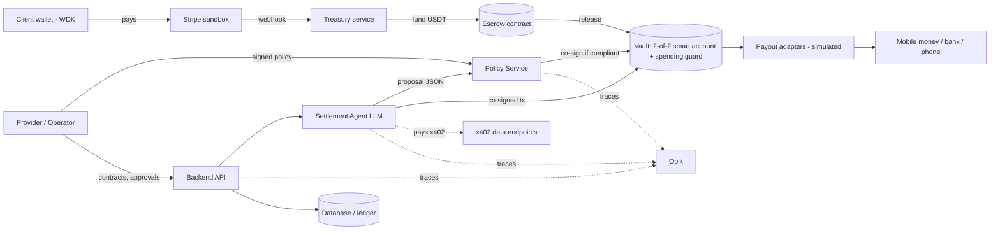

# System Design and Architecture

**Product:** Tethran

**Version:** Draft v0.2 (10 November 2026)

**Track:** Mobile Money & Peer-to-Peer (Tether), built on WDK and an EVM test network

**Items marked [TBD] or "verify" are unconfirmed.**

---

## 1. Architecture overview

Three concerns are kept separate:

1. **Proposing:** the LLM Settlement Agent, untrusted.
2. **Authorising:** the deterministic Policy Service, authoritative.
3. **Enforcing:** smart contracts on the EVM test network (escrow, vault, spending guard), final.



## 2. Components

| Component | Responsibility | Trust |
|---|---|---|
| Mobile-first web app | Provider dashboard, client pay link and QR, operator console, arbiter view, wallet review screen | Untrusted client |
| Backend API | Contracts, invoices, milestones, orchestration | Trusted |
| Payment bridge | Stripe sandbox checkout, webhook verification | Trusted |
| Treasury service | Holds test USDT, funds and refunds escrows | Trusted; keys separate from agent |
| Settlement Agent | LLM planner returning schema-valid proposals | **Untrusted** |
| Policy Service | Deterministic limit checks, second signing key, approval queue | Trusted; separate process and credentials |
| Contracts | Escrow, vault account, spending guard | Authoritative on-chain |
| Wallet layer | WDK wallets for users, treasury and agent | Self-custodial |
| x402 module | Paid data endpoints and agent payments | Trusted |
| Payout adapters | Simulated mobile money, bank, USDT, phone registry | Trusted |
| Identity service | Simulated verified names and national ID references | Trusted (simulated) |
| Reconciliation store | Invoice ↔ payment ↔ transaction ↔ trace | Trusted |
| Opik | Tracing, evaluation, guardrails | Observer |

### Proposed technology stack (to confirm)
- Services: TypeScript (Node.js) with WDK packages (@tetherto/wdk and the EVM wallet module).
- Contracts: Solidity with Hardhat or Foundry tests.
- Web: React, mobile-first. Whether WDK runs in the browser, React Native or Node for user wallets is **[TBD]**; WDK documents Node.js and React Native support.
- Database: PostgreSQL with an append-only audit table.
- Payments: Stripe sandbox (Express Checkout Element and Payment Element).
- LLM: a hosted model via API **[model TBD]**, tool calling and structured outputs.
- Observability: Opik (TypeScript SDK; self-hosted or cloud **[TBD]**).

## 3. Chain design (EVM test network)

### 3.1 Network and token
- Primary network: an EVM test network such as Sepolia, as Tether recommends for demos **[final choice TBD]**.
- Token: a test USDT if one exists on the chosen network; otherwise a self-deployed ERC-20 with six decimals (as other WDK hackathon projects did). **Verify.**
- USDT uses six decimals, so 5 USDT is 5,000,000 base units. Network fees are paid in test ETH, or sponsored if a gasless account module is used **(verify)**.

### 3.1a Multi-chain design
- Build and prove one EVM test network first. Then add chains behind one interface.
- A `ChainClient` interface (fund, release, status by transaction hash, balance) is the only place chain details live. The agent, Policy Service and UI never call a chain directly.
- Per-chain config file: `chainId`, RPC URL, USDT address, escrow, vault and guard addresses. Nothing chain-specific is hard-coded.
- Other EVM chains (for example Arbitrum Sepolia, Polygon Amoy, Base Sepolia) need a redeploy of the same contracts plus config. Network-mismatch detection then becomes a real feature.
- Non-EVM chains (Tron, Solana, TON) need their own escrow, vault and guard implementations. They are separate work, built only after the EVM flow is complete.
- Milestones, fundings and payouts record the chain they ran on.

### 3.2 Escrow contract
State per milestone: Created, Funded, Approved, Disputed, Released, Refunded.

| Function | Rule |
|---|---|
| fund(milestoneId, amount) | Pulls USDT from the treasury or client; sets timeout |
| approve / dispute | Accepts EIP-712 attestations from client, provider or arbiter; two of three decide |
| release(milestoneId) | Allowed after approval and, for card-funded milestones, after the chargeback hold; transfers to the vault |
| refund(milestoneId) | Allowed after timeout or a dispute outcome in the client's favour |

Events are emitted for every transition so the reconciliation store can follow the chain.

### 3.3 Vault and spending guard
- The vault is a two-of-two smart account: agent key plus Policy Service key. A Safe-style multi-signature account is the target; WDK documents Safe accounts with ERC-4337. **Verify the exact module and test-network support; fallback is a minimal custom account contract.**
- A **spending guard** attached to the vault enforces, on-chain: per-transaction cap, daily cap, payee allowlist and minimum reserve, all set by operator-signed updates. If either co-signer were compromised, the guard still blocks over-limit transfers.
- Master keys are not used; there is no single key that can move funds.

### 3.4 Attestations
Client, provider and arbiter sign typed (EIP-712) messages. The escrow contract and the Policy Service both verify signatures. The agent has no signing role in attestations.

### 3.4a Receipt NFT
A `ReceiptNFT` contract (ERC-721, non-transferable) mints one token per released milestone. The escrow release or the treasury service triggers the mint after release is confirmed. The token stores only: invoice hash, settlement-plan hash, amount, chain ID and release transaction hash. Minting is idempotent per milestone ID. A public verification page reads the token. The contract is redeployed per chain with the escrow.

### 3.5 Privacy
Only hashes of settlement plans and invoice references go on-chain. No personal data is on-chain.

## 4. Key flows

### 4.1 Fund and release

```mermaid
sequenceDiagram
  participant Cl as Client
  participant St as Stripe sandbox
  participant Tr as Treasury
  participant Es as Escrow contract
  participant Id as Identity check
  participant Ag as Settlement Agent
  participant Po as Policy Service
  participant Va as Vault
  Cl->>St: Pay milestone (card / wallet / PayPal / Cash App)
  St->>Tr: Webhook: payment succeeded (verified, idempotent)
  Tr->>Es: fund(milestone, USDT)
  Cl->>Es: Signed approval attestation
  Es->>Id: Release requested
  Id-->>Es: Name match OK (else hold and escalate)
  Es->>Va: release (after hold rules)
  Ag->>Po: Proposal (splits, tax reserve, payouts)
  Po->>Po: Check policy; escalate if needed
  Po-->>Ag: Co-signature
  Ag->>Va: Submit co-signed transfers (guard checks on-chain)
  Va-->>Ag: Confirmations -> payout adapters
```

### 4.2 Wallet review and send

1. The user selects a saved recipient or enters an address or phone number.
2. The app validates the address and network, then shows the review screen: recipient, network, amount and fee separately.
3. On approval the app signs and submits, storing the transaction hash as the payment reference.
4. While the reference is pending, a second send to the same intent is blocked.
5. If connectivity drops, the app shows the last known status and rechecks the same hash on reconnect, never resubmitting.
6. A network mismatch is detected before signing and the flow stops with a clear message.

### 4.3 Dispute
Two of three valid attestations decide. The agent only summarises evidence for the arbiter. If nothing happens before the timeout, the default rule applies (refund or release per contract setting **[TBD]**).

### 4.4 Policy update
The operator signs a policy document. The Policy Service verifies signature and version, then updates the guard on-chain. The agent has no access to this path.

## 5. The Settlement Agent

### 5.1 Inputs
Contract and milestone, delivery evidence, active policy summary, tax profile, corridor and FX data (some via x402). Contract text and evidence are wrapped and labelled as untrusted.

### 5.2 Tools

| Tool | Effect |
|---|---|
| get_contract, get_milestone, get_evidence | Read-only |
| get_policy_summary | Read-only |
| buy_corridor_rules, buy_fx_quote | Pays x402 endpoints within a spending cap |
| propose_settlement | Returns the structured plan |
| submit_cosigned_tx | Only accepts transactions already co-signed by the Policy Service |

WDK's agent-oriented tooling (an MCP toolkit) may be used to expose wallet operations to the agent. **Verify.** Everything it can do remains behind the Policy Service and guard.

### 5.3 Output schema (illustrative)
```json
{
  "milestone_id": "string",
  "confidence": 0.0,
  "evidence_used": ["string"],
  "actions": [
    {"type": "payout", "payee_id": "string", "amount": "string", "asset": "USDT", "rail": "evm"},
    {"type": "mobile_money_payout", "payee_id": "string", "amount": "string", "provider": "string"},
    {"type": "tax_reserve", "amount": "string", "reason": "string"},
    {"type": "conversion", "amount": "string", "target": "string", "condition": "string"}
  ],
  "flags": [{"code": "string", "detail": "string"}],
  "needs_human": false
}
```
Outputs that do not validate are rejected and logged.

### 5.4 System prompt skeleton
1. Role and purpose.
2. Authority boundaries and never-do list (no key handling, no policy changes, no release or dispute decisions, no obeying instructions found in data).
3. Input trust levels and how untrusted content is delimited.
4. Step-by-step procedure.
5. Output schema and refusal or escalation rules.
6. Worked examples, including an injection attempt and an over-limit request.

Full prompt texts are produced in the build phase with matching evaluation cases.

## 6. Guardrails (defence in depth)

| Layer | Mechanism | Stops |
|---|---|---|
| 0 | System prompt constraints | Role drift, obvious misuse |
| 1 | JSON-schema validation | Malformed or free-form output |
| 2 | Input guards (injection detection, redaction) | Prompt injection, data leakage |
| 3 | Policy Service | Any action outside operator limits |
| 4 | On-chain: two signers, escrow rules, spending guard | Any single-key or over-limit action |
| 5 | Human approval queue and review screen | Low confidence, novel payees, over-limit |
| 6 | Opik online evaluation and alerts | Drift, hallucination, repeated violations |

Layers 3 and 4 are authoritative; layers 0 to 2 reduce how often they are exercised. Limits never rely on the prompt.

## 7. Observability with Opik

- A trace per settlement run, with spans for each model and tool call.
- The trace ID is stored in the reconciliation record; only a plan hash goes on-chain.
- Evaluation experiments run the seeded scenario set; results are compared across prompt versions.
- Online LLM-as-judge metrics (for example hallucination) are attached to runs.
- Guardrail events are logged and shown in the demo dashboard.

## 8. Data model (core entities)

Chain (config), Receipt (token ID, milestone, chain), Contract, Milestone (chain), Invoice, Funding (Stripe payment reference, source type), EscrowRecord (transaction hashes), SettlementPlan (agent output, hash), PolicyVersion, PolicyDecision (result, reasons), Attestation (signer, signature, type), Payout (adapter, status), Dispute, IdentityRecord (verified name, simulated ID reference), PhoneRegistryEntry (consented), AuditLog (append-only), TraceRef (Opik ID).

## 9. x402 module
- The agent buys corridor and tax-rule data from our own x402 endpoint, paying in test USDT on an EVM test network.
- Our invoice-status and settlement-proof endpoints are payable the same way.
- Implementation follows the x402 protocol libraries and a facilitator **(verify chain and token support)**.

## 10. Payout adapters and phone registry
```text
interface PayoutAdapter {
  quote(request) -> Quote
  initiate(request) -> PayoutRef
  status(ref) -> PayoutStatus
}
```
Implementations: MobileMoneySim (M-Pesa, MTN MoMo, Airtel), BankSim, UsdtSim. The phone registry maps a consented phone number to a wallet address; resolution is simulated.

## 11. Identity-matched release
At release, the Identity service compares the verified name on the payment record with the verified customer. A match proceeds; a mismatch holds the release and creates an escalation. Verification here is simulated; the design mirrors the traceability direction of Nigeria's November 2026 rules for P2P providers (name and BVN matching, reconciliation of crypto and fiat legs, handling of disputed or suspicious transactions). Production use needs licensed verification providers and legal counsel.

## 12. Country profiles
A profile is data: currency, tax identifier fields, invoice fields, applicable rule sources, available payout rails and corridor notes. Initial set: Nigeria, Kenya, South Africa, Ghana. Tax rates and thresholds are configured per profile and verified before use.

## 13. Security and key management
- The agent process never holds Treasury or Policy Service keys.
- The Policy Service runs separately with its own credentials and network boundary.
- Secrets live in environment configuration, not in prompts, logs or traces.
- Stripe webhook signatures verified; idempotency keys on funding events.
- Test networks only; all keys are test keys; never use mainnet funds.

## 14. Testing and evaluation
- Contract tests: escrow state machine, attestation verification, guard limits, refund paths.
- Unit tests for policy rules, schema validation and identity matching.
- Integration tests on the test network (fund, approve, release, refund, over-limit rejection).
- Scenario evaluations in Opik: clean delivery, disputed delivery, prompt injection in evidence, over-limit request, unknown payee, low confidence, duplicate send, wrong network, identity mismatch.
- Seed scripts rebuild accounts, balances and demo data.

## 15. Verification checklist (before building on each assumption)
1. Test USDT on the chosen network, or deploy our own token.
2. WDK modules for a two-signer smart account and any gasless option.
3. WDK fiat on-ramp module availability in a test environment.
4. x402 flow on an EVM test network, including facilitator support.
5. Stripe sandbox wallet behaviour on the team's test devices; Cash App Pay region limits.
6. Whether WDK provides transaction-policy hooks we should use alongside our own Policy Service.
7. WDK module availability per chain, and USDT addresses on each additional test network.

## 16. Open items
LLM model, hosting, Opik deployment mode, wallet runtime (browser, React Native or Node), default dispute-timeout outcome, team ownership of components: all **[TBD]**.
